# zplkit

Render a ZPL label template and send it straight to a network label
printer (raw TCP, port 9100 by default).

Contributing to this repo means adding or editing `.zpl` templates — no Go
required. See [Adding a template](#adding-a-template).

## Compiling

### Using Make (recommended)

```sh
make build
```

Produces `build/zplkit`.

### Using Go directly

```sh
go build -o zplkit ./cmd/zplkit
```

## Setup

```sh
cp zplkit.toml.example zplkit.toml
$EDITOR zplkit.toml   # set company_name, asset_url, and optionally your own [aliases]
```

`zplkit.toml` is git-ignored — it's where your real company name, asset
URL, default printer backend/endpoint, template aliases, and declared
template categories live. `zplkit.toml.example` stays in the repo as the
documented template for it. No aliases ship by default (including
`default`, the `-t` flag's own default value) — add your own short names
for whichever templates you actually use.

## Usage

`zplkit` has four subcommands: `print`, `admin`, `version`, `help`.

```sh
./zplkit print -t asset-tag/2x1/001 TAG       # render by explicit path
./zplkit print -t default TAG                 # render by alias, if you've defined one
./zplkit print -t asset-tag/2x1/001 -f Tag=TAG  # TAG via --field instead of positionally
./zplkit print -t asset-tag/2x1/001 -d TAG    # dry run: write rendered ZPL to stdout
./zplkit print -l                             # list templates, categories, and aliases
./zplkit admin clock                          # set the printer's real-time clock to now
./zplkit admin -d darkness 15                 # dry run: write a built-in action's ZPL to stdout
./zplkit admin setup/store-logo.zpl           # anything else: send a raw ZPL file straight through
./zplkit version                              # print the version (also --version, -V)
./zplkit help [print|admin|version]           # usage (also --help, -h)
```

`TAG` is optional on `print` — not every template needs one (see
[Placeholders](#placeholders)) — but if given, either positionally or via
`--field Tag=...`, it must match `^[A-Z]{2,4}-[0-9]{6}$` (e.g.
`ABC-000001`).

### `print` flags

| Flag | Env var | Config key | Default | Description |
| --- | --- | --- | --- | --- |
| `-t, --template` | — | — | `default` | Template name, alias, or path |
| `-f, --field` | — | — | — | Set a template field as `KEY=VALUE` (repeatable) |
| `-d, --dry-run` | — | — | off | Write rendered ZPL to stdout instead of printing |
| `-l, --list` | — | — | off | List templates and aliases |
| `--backend` | `ZPLKIT_BACKEND` | `printer.backend` | `socket` | Delivery backend: `socket` or `ipp` |
| `--endpoint` | `ZPLKIT_ENDPOINT` | `printer.endpoint` | `printer.example.net:9100` | Where to send it (see below) |
| `--document-format` | `ZPLKIT_DOCUMENT_FORMAT` | `printer.document_format` | `application/octet-stream` | IPP document-format, `ipp` backend only |
| `--templates` | `ZPLKIT_TEMPLATES` | — | `templates` | Template directory |
| `--config` | `ZPLKIT_CONFIG` | — | `zplkit.toml` | Config file path |
| `--timeout` | `ZPLKIT_TIMEOUT` | — | `5` | Connect/send timeout, seconds |

### `admin` flags

`admin` is for printer-side provisioning that isn't tied to a specific
asset tag. Its one positional argument is either a built-in action name
— `clock`, `darkness LEVEL`, `calibrate`, `speed LEVEL` (see [Printer
provisioning](#printer-provisioning-admin)) — or, for anything else
(e.g. storing a logo via `~DG`), a `.zpl` file path, sent as-is: no
template resolution, no `TAG`, no `{{.Field}}` rendering. It takes the
same `-d`/`--backend`/`--endpoint`/`--document-format`/`--config`/
`--timeout` flags as `print` (no `--template`/`--list`/`--templates`,
since there's no template involved).

The printer settings (`backend`/`endpoint`/`document-format`, shared by
`print` and `admin`) each have four possible sources; precedence is CLI
flag > its `ZPLKIT_*` environment variable > `zplkit.toml`'s `[printer]`
table > the built-in default. Everything else in `zplkit.toml`
(`company_name`, `asset_url`, `[aliases]`) has no flag/env equivalent —
it's config-only.

### Printer backends

- **`socket`** (default) dials `endpoint` ("host:port") directly and
  writes raw ZPL — the traditional way to talk to a Zebra printer, and
  what CUPS's own `socket://` raw backend does under the hood.
- **`ipp`** submits an IPP Print-Job to `endpoint` (the printer resource's
  full http(s) URL, e.g. `http://lprint-host:8000/ipp/print/zebra1`) with
  `document-format` as the IPP document-format attribute. Use this once
  the printer is fronted by [LPrint](https://www.msweet.org/lprint/) (or
  another IPP Everywhere service) instead of exposing its own raw socket —
  CUPS is deprecating raw queues in favor of IPP Everywhere, and LPrint is
  the maintainer-recommended replacement for label/receipt printers. The
  exact resource path and document-format your LPrint instance expects
  depend on its configuration; check `lprint printers` / `lprint drivers`.

`zplkit` resolves `templates`/`zplkit.toml` relative to the current
directory by default — run it from the repo root, or point `--templates`/
`--config` (or their env vars) at wherever you've deployed them.

## Templates

Templates live under `templates/<category>/<size>/`: one top-level
directory per *category* — what the label is for (`asset-tag`,
`mail-to`, `mail-from`, `name` today; nothing stops adding more) — and
one subdirectory per physical label size within
it (e.g. `2x1`, `2.25x1.25`). Within a size, `.zpl` files are named by a
plain sequential catalog number (`001`, `002`, ...), not a description of
their contents — a label's feature set (which barcode symbologies, border
or no border, text above/below the barcode, and so on) is combinatorial
enough that trying to encode all of it into the filename stops being
readable fast. What a template actually contains is documented in the
table below (and in its own `^FX` summary comment, and its alias, if it
has one) instead. Each `.zpl` file has a PNG preview of the same name,
rendered via the [Labelary](http://labelary.com/viewer.html) API, so you
can see what a template looks like without a printer.

`zplkit.toml`'s `categories` list (see `zplkit.toml.example`) is a purely
informational record of which category directories are in use, shown by
`print -l` — it's never enforced, so a category that exists under
`templates/` but isn't listed there yet still works.

Each category directory has its own `README.md` with field details and
any ZPL quirks specific to it; the tables below are just a map of
what's there.

### `asset-tag`

| Preview | Path | Fields |
| --- | --- | --- |
| 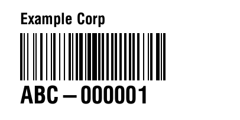 | `asset-tag/2x1/001` | company name, Code 128, human-readable tag |
| 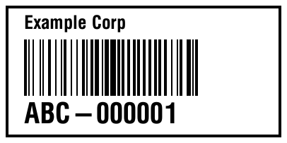 | `asset-tag/2x1/002` | square border, company name, Code 128, human-readable tag |
|  | `asset-tag/2x1/003` | company name, return contact, Code 128, tag |
|  | `asset-tag/2x1/004` | square border, company name, return contact, Code 128, tag |
| 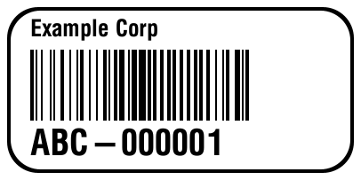 | `asset-tag/2x1/005` | rounded border, company name, Code 128, human-readable tag |
| 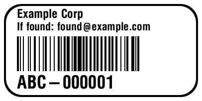 | `asset-tag/2x1/006` | rounded border, company name, return contact, Code 128, tag |
| 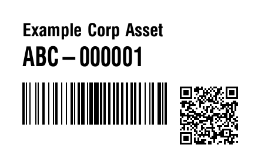 | `asset-tag/2.25x1.25/001` | company name, tag, Code 128, QR to asset URL |
| 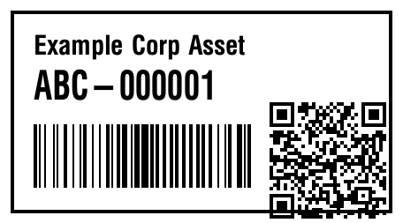 | `asset-tag/2.25x1.25/002` | square border, company name, tag, Code 128, QR to asset URL |
| 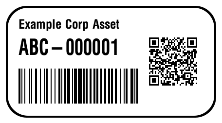 | `asset-tag/2.25x1.25/003` | rounded border, company name, tag, Code 128, QR to asset URL |

See `templates/asset-tag/README.md` for field details and a couple of
ZPL gotchas (the QR/barcode interaction, `fitfont` sizing).

### `mail-to`

| Preview | Path | Fields |
| --- | --- | --- |
|  | `mail-to/2.25x1.25/001` | name, street address, city/state/ZIP |
| 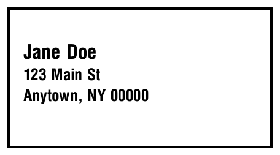 | `mail-to/2.25x1.25/002` | square border, name, street address, city/state/ZIP |
| 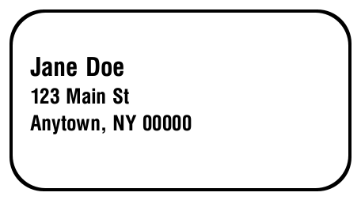 | `mail-to/2.25x1.25/003` | rounded border, name, street address, city/state/ZIP |

See `templates/mail-to/README.md` for field details.

### `mail-from`

| Preview | Path | Fields |
| --- | --- | --- |
|  | `mail-from/2.25x1.25/001` | company name, name, street address, city/state/ZIP |
| 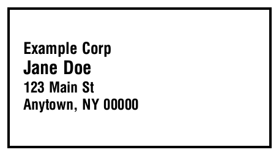 | `mail-from/2.25x1.25/002` | square border, company name, name, street address, city/state/ZIP |
| 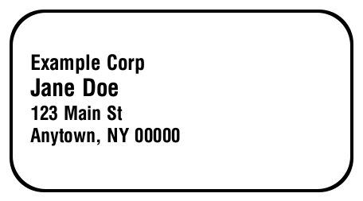 | `mail-from/2.25x1.25/003` | rounded border, company name, name, street address, city/state/ZIP |

See `templates/mail-from/README.md` for field details.

### `name`

| Preview | Path | Fields |
| --- | --- | --- |
|  | `name/2.25x1.25/001` | name, centered |
|  | `name/2.25x1.25/002` | square border, name, centered |
|  | `name/2.25x1.25/003` | rounded border, name, centered |

See `templates/name/README.md` for field details, including how to
get a second line out of `Name`.

### Template style

- One `^FX` comment line above each field block (`^FO`/`^A0`/`^BC`/`^BQ`/
  etc. through its closing `^FD...^FS`), naming what the field is — not
  what command it is, and not why/how (that belongs in the category's
  `README.md`, not the `.zpl` file).
- Blank line between field blocks, and between the header directives
  (`^CI28`/`^PW`/`^LL`/`^LH`) and the first field.
- Each ZPL command on its own line within a block (`^FO`, `^BY`, `^BC`,
  `^FD` each on their own line, rather than chained on one line).
- A single `^FX` summary comment right after `^XA`: `<category>/<size>/
  <number> - <size> @ 203 dpi: <comma-separated field list>`. The field
  list is the one place (besides the table above) a template's contents
  need to be spelled out — the filename itself stays just a number.

See `templates/asset-tag/2.25x1.25/001.zpl` for a template that follows
this fully, and that category's `README.md` for the `^BY`/`^BQ` gotcha
a template combining a barcode and a QR code needs to know about.

### Placeholders

Templates are rendered with Go's [`text/template`](https://pkg.go.dev/text/template),
so placeholders use Go's `{{.Field}}` syntax. A template can reference any
field name it needs — there's no fixed list — supplied from two sources:

- `{{.CompanyName}}` / `{{.AssetURL}}` — always set, from `zplkit.toml`'s
  `company_name` / `asset_url`.
- Anything else, via a repeatable `-f`/`--field KEY=VALUE` flag on
  `print`. `{{.Tag}}` (checked against `^[A-Z]{2,4}-[0-9]{6}$`) is set
  by `print`'s positional `TAG` argument as shorthand for `-f Tag=...`;
  `mail-to`/`mail-from` use `{{.Name}}`/`{{.Address1}}`/`{{.City}}`/
  `{{.State}}`/`{{.ZIP}}`, set via `-f Name="Jane Doe" -f Address1="123
  Main St" -f City=Springfield -f State=IL -f ZIP=62701` (one `-f` per
  field — a field's value isn't comma-split, so addresses containing
  commas are safe).

Referencing a field that doesn't exist (a typo, or one nobody supplied
via `-f`) is a hard error at render time, not a silently blank or literal
`{{...}}` in the output. Every field value is also rejected if it
contains `^` or `~` (ZPL command prefixes), regardless of which field or
where its value came from.

Templates also have three built-in template functions beyond Go's own
(`len`, `printf`, etc.):

- `{{fitfont <text> <maxWidthDots> <maxFont> <minFont>}}` returns an
  `^A0` font size (dots) that keeps `<text>` within `<maxWidthDots>`,
  shrinking from `<maxFont>` down to `<minFont>` as needed — text too
  long even at `<minFont>` still gets `<minFont>` rather than wrapping.
  It's an estimate (`^A0` is proportionally spaced, not monospace)
  biased to avoid overflow rather than to be exact. If `<text>`
  contains a line break (see `zplbreak` below), the estimate is based
  on its longest line, so a short first line doesn't let a long second
  one run wide.
- `{{zplbreak <text>}}` converts a literal newline in `<text>` into
  ZPL's own explicit line-break sequence, `\&`, recognized inside an
  `^FB` (Field Block) command — a raw newline byte has no defined
  meaning inside `^FD...^FS` and broke Labelary's parser when tried
  directly, so route any field that might contain one through this
  before putting it in `^FD`, not `{{.Field}}` directly.
- `{{linecount <text>}}` returns how many lines `<text>` has (1 if no
  newline), for picking field-origin coordinates that center a
  1-or-2-line block correctly — see the `{{if gt $n 1}}...{{end}}` in
  `templates/name/2.25x1.25/001.zpl`.

A field value containing a real newline (e.g.
`-f Name=$'Cables:\nUSB-C'` — bash's `$'...'` quoting, not `"..."`,
which leaves `\n` as two literal characters) only renders as a line
break on a template that explicitly uses `zplbreak`/`linecount` and an
`^FB` with more than one line, like `name`'s. A template that
substitutes `{{.Field}}` directly still renders a literal newline byte
as-is, which most ZPL parsers don't handle well.

### Adding a template

1. Drop a `.zpl` file under `templates/<category>/<size>/`, named with
   the next unused catalog number in that directory (`001`, `002`, ...)
   — not a description of its contents, see [Templates](#templates)
   above — where `<category>` is what the label is for (reuse an
   existing one, e.g. `asset-tag`, or introduce a new one) and `<size>`
   is the label's physical dimensions as `WIDTHxHEIGHT` in inches. Follow
   the style above.
2. Use the placeholders above as needed — any field your template
   references via `{{.Field}}` must be supplied at print time via
   `-f Field=value` (or be `CompanyName`/`AssetURL`, which are automatic).
3. Generate a preview of the same number so it shows up here and in `-l`:

   ```sh
   cp zplkit.toml.example zplkit.toml   # if you don't already have one
   ./zplkit print -d -t <category>/<size>/<number> -f Tag=ABC-000001 \
     | curl -s -X POST --data-binary @- \
       "http://api.labelary.com/v1/printers/8dpmm/labels/<size>/0/" \
       -o templates/<category>/<size>/<number>.png
   ```

   (swap `-f Tag=ABC-000001` for whatever `-f`/positional values your
   template actually needs)

4. Add a row to the relevant category's table above describing what it
   contains — this is the template's real documentation, since the
   filename itself won't say. Introducing a brand-new category also means
   adding its own `###` subsection and table (see `### asset-tag` above),
   and adding its name to `categories` in `zplkit.toml.example`.
5. If you want a short name for it, add an `<alias> =
   "<category>/<size>/<number>"` line under `[aliases]` in your own
   `zplkit.toml` — aliases are a local, per-deployment convenience and
   don't belong in `zplkit.toml.example`.

## Printer provisioning (`admin`)

Some printer setup isn't tied to any one asset tag — setting the clock,
print darkness, calibration, print speed. `admin` has a built-in action
for each of these:

```sh
./zplkit admin clock              # set the printer's real-time clock to now
./zplkit admin darkness 15        # set print darkness (0-30)
./zplkit admin calibrate          # run label length/gap sensor calibration
./zplkit admin speed 4            # set print speed, inches/second (1-14)
./zplkit admin -d darkness 15     # dry run any action: write the ZPL to stdout instead of sending it
```

`darkness` and `speed` are saved with `^JUS` so they survive a power
cycle; `clock` and `calibrate` write directly to the printer and don't
need that.

For anything else not tied to an asset tag — storing a logo in flash
(`~DG`), or any other provisioning not covered by a built-in action —
write it as a plain `.zpl` file (no `{{.Field}}` placeholders — `admin`
sends the file as-is whenever its first argument isn't a known action
name) and send it the same way:

```sh
./zplkit admin -d setup/store-logo.zpl    # dry run: see what would be sent
./zplkit admin setup/store-logo.zpl       # send it
```

There's no required location for these files; put them wherever makes
sense for your setup (a `setup/` directory alongside `templates/` is a
reasonable convention, but `admin` takes any path).

## Testing

```sh
make test
make vet
```
