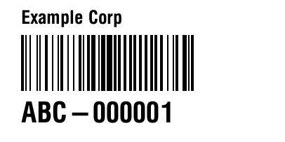
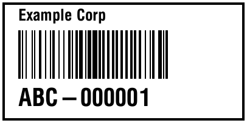
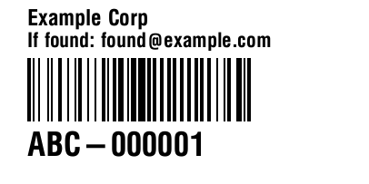
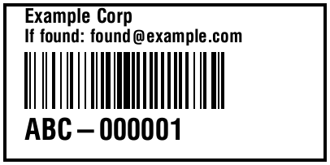
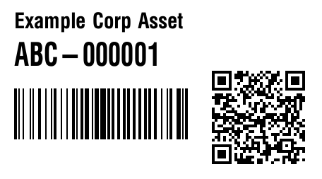
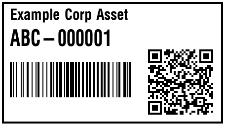

# zplkit

Render a ZPL label template for an asset tag and send it straight to a
network label printer (raw TCP, port 9100 by default).

Contributing to this repo means adding or editing `.zpl` templates — no Go
required. See [Adding a template](#adding-a-template).

## Compiling

### Using Make (recommended)

```sh
make build
```

Produces `build/zplkit`.

### Using Go directly

```sh
go build -o zplkit ./cmd/zplkit
```

## Setup

```sh
cp zplkit.toml.example zplkit.toml
$EDITOR zplkit.toml   # set company_name, asset_url, aliases
```

`zplkit.toml` is git-ignored — it's where your real company name, asset
URL, default printer backend/endpoint, and template aliases live.
`zplkit.toml.example` stays in the repo as the documented template for it.

## Usage

`zplkit` has four subcommands: `print`, `admin`, `version`, `help`.

```sh
./zplkit print TAG                        # render the default template and print it
./zplkit print -t qr TAG                   # render by alias
./zplkit print -t 2x1/code128 TAG          # render by explicit path
./zplkit print -d TAG                      # dry run: write rendered ZPL to stdout
./zplkit print -l                          # list templates and aliases
./zplkit admin -d setup/set-clock.zpl      # dry run: write a raw ZPL file to stdout
./zplkit admin setup/set-clock.zpl         # send a raw ZPL file straight to the printer
./zplkit version                           # print the version (also --version, -V)
./zplkit help [print|admin|version]        # usage (also --help, -h)
```

`TAG` must match `^[A-Z]{2,4}-[0-9]{6}$` (e.g. `ABC-000001`).

### `print` flags

| Flag | Env var | Config key | Default | Description |
| --- | --- | --- | --- | --- |
| `-t, --template` | — | — | `default` | Template name, alias, or path |
| `-d, --dry-run` | — | — | off | Write rendered ZPL to stdout instead of printing |
| `-l, --list` | — | — | off | List templates and aliases |
| `--backend` | `ZPLKIT_BACKEND` | `printer.backend` | `socket` | Delivery backend: `socket` or `ipp` |
| `--endpoint` | `ZPLKIT_ENDPOINT` | `printer.endpoint` | `printer.example.net:9100` | Where to send it (see below) |
| `--document-format` | `ZPLKIT_DOCUMENT_FORMAT` | `printer.document_format` | `application/octet-stream` | IPP document-format, `ipp` backend only |
| `--templates` | `ZPLKIT_TEMPLATES` | — | `templates` | Template directory |
| `--config` | `ZPLKIT_CONFIG` | — | `zplkit.toml` | Config file path |
| `--timeout` | `ZPLKIT_TIMEOUT` | — | `5` | Connect/send timeout, seconds |

### `admin` flags

`admin` sends a `.zpl` file straight to the printer — no template
resolution, no `TAG`, no `{{.Field}}` rendering. Use it for printer-side
provisioning that isn't tied to a specific asset tag: storing a logo
(`~DG`), setting the real-time clock (`^SC`), calibration, and similar
one-off setup. It takes the same `-d`/`--backend`/`--endpoint`/
`--document-format`/`--config`/`--timeout` flags as `print` (no
`--template`/`--list`/`--templates`, since there's no template involved),
plus a required `FILE` argument.

The printer settings (`backend`/`endpoint`/`document-format`, shared by
`print` and `admin`) each have four possible sources; precedence is CLI
flag > its `ZPLKIT_*` environment variable > `zplkit.toml`'s `[printer]`
table > the built-in default. Everything else in `zplkit.toml`
(`company_name`, `asset_url`, `[aliases]`) has no flag/env equivalent —
it's config-only.

### Printer backends

- **`socket`** (default) dials `endpoint` ("host:port") directly and
  writes raw ZPL — the traditional way to talk to a Zebra printer, and
  what CUPS's own `socket://` raw backend does under the hood.
- **`ipp`** submits an IPP Print-Job to `endpoint` (the printer resource's
  full http(s) URL, e.g. `http://lprint-host:8000/ipp/print/zebra1`) with
  `document-format` as the IPP document-format attribute. Use this once
  the printer is fronted by [LPrint](https://www.msweet.org/lprint/) (or
  another IPP Everywhere service) instead of exposing its own raw socket —
  CUPS is deprecating raw queues in favor of IPP Everywhere, and LPrint is
  the maintainer-recommended replacement for label/receipt printers. The
  exact resource path and document-format your LPrint instance expects
  depend on its configuration; check `lprint printers` / `lprint drivers`.

`zplkit` resolves `templates`/`zplkit.toml` relative to the current
directory by default — run it from the repo root, or point `--templates`/
`--config` (or their env vars) at wherever you've deployed them.

## Templates

Templates live under `templates/<size>/`, one subdirectory per physical
label size (e.g. `2x1`, `2.25x1.25`). Each `.zpl` file has a PNG preview of
the same name, rendered via the [Labelary](http://labelary.com/viewer.html)
API, so you can see what a template looks like without a printer.

| Preview | Path | Fields | Default alias |
| --- | --- | --- | --- |
|  | `2x1/code128` | company name, Code 128, human-readable tag | `default` |
|  | `2x1/code128-border` | border, company name, Code 128, human-readable tag | `default-border` |
|  | `2x1/contact-code128` | company name, return contact, Code 128, tag | `field` |
|  | `2x1/contact-code128-border` | border, company name, return contact, Code 128, tag | `field-border` |
|  | `2.25x1.25/code128-qr` | company name, tag, Code 128, QR to asset URL | `qr` |
|  | `2.25x1.25/code128-qr-border` | border, company name, tag, Code 128, QR to asset URL | `qr-border` |

### Template style

- One `^FX` comment line above each field block (`^FO`/`^A0`/`^BC`/`^BQ`/
  etc. through its closing `^FD...^FS`), describing what the field is —
  not just what command it is.
- Blank line between field blocks, and between the header directives
  (`^CI28`/`^PW`/`^LL`/`^LH`) and the first field.
- Each ZPL command on its own line within a block (`^FO`, `^BY`, `^BC`,
  `^FD` each on their own line, rather than chained on one line).
- A single `^FX` summary comment right after `^XA`: `<name> - <size> @
  203 dpi: <comma-separated field list>`.

See `templates/2.25x1.25/code128-qr.zpl` for a template that follows
this fully.

### Placeholders

Templates are rendered with Go's [`text/template`](https://pkg.go.dev/text/template),
so placeholders use Go's `{{.Field}}` syntax:

- `{{.Tag}}` — the asset tag passed on the command line.
- `{{.CompanyName}}` — from `zplkit.toml`'s `company_name`.
- `{{.AssetURL}}` — from `zplkit.toml`'s `asset_url`.

Referencing a field that doesn't exist (a typo) is a hard error at render
time, not a silently blank or literal `{{...}}` in the output.

### Adding a template

1. Drop a `.zpl` file under `templates/<size>/`, named for what it
   contains (e.g. `code128-qr`, or `code128-qr-border` for a bordered
   variant), where `<size>` is the label's physical dimensions as
   `WIDTHxHEIGHT` in inches. Follow the style above.
2. Use the placeholders above as needed.
3. Generate a preview of the same name so it shows up here and in `-l`:

   ```sh
   cp zplkit.toml.example zplkit.toml   # if you don't already have one
   ./zplkit print -d -t <size>/<name> ABC-000001 \
     | curl -s -X POST --data-binary @- \
       "http://api.labelary.com/v1/printers/8dpmm/labels/<size>/0/" \
       -o templates/<size>/<name>.png
   ```

4. Optionally add an `<alias> = "<size>/<name>"` line under `[aliases]` in
   `zplkit.toml.example` so others get a short name for it too.

## Printer provisioning (`admin`)

Some printer setup isn't tied to any one asset tag — storing a logo in
flash, setting the clock, calibration. Write it as a plain `.zpl` file
(no `{{.Field}}` placeholders — `admin` sends the file as-is) and send it
with `zplkit admin`:

```sh
./zplkit admin -d setup/set-clock.zpl     # dry run: see what would be sent
./zplkit admin setup/set-clock.zpl        # send it
```

There's no required location for these files; put them wherever makes
sense for your setup (a `setup/` directory alongside `templates/` is a
reasonable convention, but `admin` takes any path).

## Testing

```sh
make test
make vet
```
